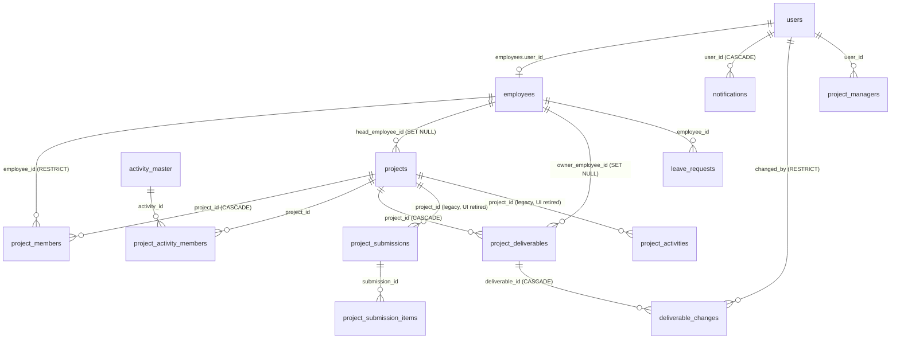

# Phase 1 Audit - Project Deliverables & Submission Deadline Tracker

- **Date:** 2026-11-11
- **Branch inspected:** `fix/deliverables` (working tree clean at start and end of audit)
- **DB inspected:** `wms-db-1`, alembic head `0088_attendance_comp_off_link` (read-only transaction, rolled back)
- **Scope:** inspection only. No source, schema, migration, permission or behaviour change was made. This file is the only artefact written.

Evidence labels: **[C]** confirmed by source or safe execution - **[I]** inferred from implementation - **[U]** unverified, needs testing.
Capability labels: **[C]** implemented - **[P]** partial - **[M]** missing - **[U]** unverified.

---

## Section 1 - Executive summary

A working Deliverables module already exists, end to end, and covers the core of the requested tracker:

- A `project_deliverables` table with a per-deliverable **due date** (`target_date`, labelled "Planned Submission" in the UI), a **status** (`planned` / `completed`), a **completion date** column, a project FK and a free-text activity name. [C]
- An **append-only change history** (`deliverable_changes`) that records every due-date change and status reversal, with a mandatory reason. Completions are logged with a system reason. Changes are mirrored into `audit_logs`. [C]
- A global, cross-project list (`GET /deliverables`), a per-project list, a detail endpoint, a history endpoint and create/update/delete endpoints. [C]
- A **PM-wide / member-scoped backend visibility model**. PMs see every project. Everyone else sees only projects where they have a `project_members` row. [C]
- Frontend: an all-deliverables page (`/projects/deliverables`) with PM create/edit/delete, a detail page (`/projects/deliverables/{id}`) with a Timeline, and a Deliverables card on the PM dashboard. [C]
- **Event notifications** (planned / date updated / completed) that deep-link to the deliverable detail page. [C]

The "leave-request blocking" is **not blocking**. It is a PM-only, informational "Deliverable Impact" warning (±2 days around a Planned deliverable's due date) that never prevents approval. [C] It must be preserved as-is.

What is **genuinely missing**: the five-day reminder ladder (5..2 / 1 urgent / due today / overdue), any derived overdue or due-today state, summary cards, search/filter controls, a PM reminder panel, a captured **submission date** when marking completed, and an activity *type* (FMTL / MTL / DOC IDB / PM IDB are only free text today).

**Estimated reuse:** about 70% of the requested capability exists. The remaining work is mostly derived (computed) state plus UI. It needs **no new table**. At most it needs a small, optional schema addition (see Section 9).

Two facts that change the plan:
1. The memory note "Deliverable Reminder ... GET /deliverables/reminders/me" (2026-06-30) is **not in the codebase on any branch**. `git log -S "reminders/me" --all` returns nothing, and the router has no such route. Treat that note as stale. Reminders must be built. [C]
2. **ADR-003** (`docs/ADR-003-project-progress-and-submission-model.md`) still declares Deliverables "superseded" and states that "No automated overdue status or health badge is derived from it" (line 66). The module was later revived (migrations 0045/0047), and this enhancement explicitly adds overdue status. The ADR needs an amendment or a superseding decision before Phase 2. [C]

### Confirmed decisions (2026-11-11)

These supersede the open questions in Section 12 and drive the revised plan in Sections 9-10.

| # | Decision |
|---|---|
| D1 | **Manage** (create / edit deadline / change status / delete): PM on all projects, and the assigned **Project Head** on their own projects only. Nobody else. Not team leads. Backend-enforced |
| D2 | **View**: PM all projects. Everyone else only projects they belong to or head |
| D3 | **No activity-type system.** Free-text activity name stays. No new tables |
| D4 | **Reminders live on the existing PM dashboard Deliverables card** (enhanced) and the Deliverables page. No login banner, no new bell workflow for now |
| D5 | **ADR-003 amended** (Amendment 2). Overdue is a dynamically computed state. `planned`/`completed` storage is unchanged. Deliverable Impact must keep working |
| D6 | IST "today", deleted-project filtering, preserved history/audit, no unnecessary migrations, leave untouched |

---

## Section 2 - Existing Deliverables implementation

### 2.1 Files

| Layer | File | What it does |
|---|---|---|
| Model | `backend/app/modules/project_deliverables/models.py:29-59` | `ProjectDeliverable`: `project_id`, `name`, `description`, `planned_start_date`, `target_date`, `owner_employee_id`, `status`, `completion_date` |
| Model | `backend/app/modules/project_deliverables/models.py:63-99` | `DeliverableChangeField` constants plus the `DeliverableChange` append-only log |
| Schemas | `backend/app/modules/project_deliverables/schemas.py:10-63` | `DeliverableOut` (adds `project_name`, `project_code`, `owner_name`), `DeliverableCreate`, `DeliverableUpdate` (+`reason`), `DeliverableChangeOut` |
| Router | `backend/app/modules/project_deliverables/router.py:33-122` | 7 endpoints (below), mounted at `backend/app/main.py:125` |
| Service | `backend/app/modules/project_deliverables/service.py` | RBAC helpers (35-64), global list (107-143), notifications (151-194), CRUD (215-484) |
| Migrations | `backend/alembic/versions/0029_project_deliverables.py`, `0045_deliverable_changes.py`, `0047_deliverable_status_planned.py` | Create table; add `planned_start_date` + `deliverable_changes`; collapse status enum to `planned`/`completed` |
| Page | `frontend/src/app/(app)/projects/deliverables/page.tsx` | Wraps `AllDeliverablesView` in `RequireCapability("project.view")` |
| Page | `frontend/src/app/(app)/projects/deliverables/[id]/page.tsx` | Wraps `DeliverableDetail` |
| Component | `frontend/src/features/project-deliverables/components/all-deliverables-view.tsx` | Global table + inline create/edit form + delete dialog |
| Component | `frontend/src/features/project-deliverables/components/deliverable-detail.tsx` | Info card + Timeline (change history) |
| Component | `frontend/src/features/project-deliverables/components/status-badge.tsx` | `planned` = warning, `completed` = success |
| Component | `frontend/src/features/project-deliverables/components/deliverables-tab.tsx` | **Orphaned**: imported nowhere (see 2.4) |
| Data | `frontend/src/features/project-deliverables/{api,hooks,keys,schemas,types}.ts` | TanStack Query hooks, zod form schema, types |
| Hub | `frontend/src/app/(app)/projects/page.tsx:48-53` | "Deliverables" hub card on `/projects` |
| Dashboard | `frontend/src/features/dashboard/project-manager-dashboard.tsx:47,76-150` | PM "Deliverables" card (top 6, planned first, by due date) |

### 2.2 API endpoints [C]

| Method | Path | Auth (service) |
|---|---|---|
| GET | `/api/v1/deliverables` | PM: all live projects. Others: projects with a `project_members` row (`service.py:107-143`) |
| GET | `/api/v1/deliverables/{id}` | `_assert_member` (`service.py:432-443`) |
| GET | `/api/v1/deliverables/{id}/changes` | `_assert_member` (`service.py:446-470`) |
| GET | `/api/v1/projects/{pid}/deliverables` | `_assert_member` (`service.py:215-233`) |
| POST | `/api/v1/projects/{pid}/deliverables` | `_assert_can_manage` = PM or project `team_lead` (`service.py:236-267`) |
| PATCH | `/api/v1/projects/{pid}/deliverables/{id}` | `_assert_can_manage` (`service.py:274-429`) |
| DELETE | `/api/v1/projects/{pid}/deliverables/{id}` | `_assert_can_manage`, hard delete (`service.py:473-484`) |

### 2.3 Capability matrix

| Capability | Label | Evidence |
|---|---|---|
| View deliverables across all projects (PM) | [C] | `service.py:114-115` selects every live project for PM. `all-deliverables-view.tsx:359` |
| Create deliverable for any project (PM) | [C] | Project selector `all-deliverables-view.tsx:169-185`, fed by `useProjects({status:"active", limit:100})` (line 360) |
| Select project | [C] | As above. Locked on edit |
| Select activity | [P] | Free-text "Activity Name" (`all-deliverables-view.tsx:187-199`, model `name: Text`). No link to `activity_master` or `activity_types` |
| Set submission deadline | [C] | `target_date`, "Planned Submission" input (`all-deliverables-view.tsx:226-238`) |
| Edit deadline | [C] | PATCH with mandatory reason. Backend 422 at `service.py:330-336`, client check at `all-deliverables-view.tsx:117-135` |
| View submission status | [P] | Only `planned` / `completed`. No derived upcoming / due-today / overdue |
| Record submission completion | [P] | Status -> `completed` logs a timeline row and notifies. **`completion_date` is not exposed in the global form**, so it stays NULL. DB: 1 completed row, `completion_date` NULL [C] |
| View submission history | [C] | `deliverable_changes` + Timeline (`deliverable-detail.tsx:75-143`). DB: 9 rows (5 `due_date`, 4 `status`) |
| Audit logging | [C] | `audit.record_audit(... DELIVERABLE_FIELD_CHANGE ...)` at `service.py:352-364, 377-389`. Constants `audit/constants.py:13,58` |
| Create / delete audited | [M] | Create and delete write no `deliverable_changes` or `audit_logs` row (`service.py:236-267, 473-484`) |
| Owner | [P] | Column and API exist. Global form does not expose it. DB: 0 rows with owner |
| Search / filters | [M] | No search, project filter or status filter on `/projects/deliverables`. Server sort only (`target_date ASC NULLS LAST`) |
| Summary cards | [M] | None |
| Overdue / due-today / days-left | [M] | No computation anywhere (backend or frontend) |
| Reminders | [M] | See Section 4 |
| Deep link to a deliverable | [C] | Detail route `/projects/deliverables/{id}`. Used by notifications, dashboard, leave detail |
| Edit from detail page | [M] | Detail page is read-only. Edit lives only in the list form |
| Tests for deliverables module | [M] | No `backend/tests/*deliverable*`. Only leave-impact tests touch it (Section 3) |

### 2.4 Defects / dead code found (not fixed)

> **Status 2026-11-11 (Phase 5):** `DeliverablesTab` and the unused timeline
> schema were **removed**. The "who" defect was already fixed: the history now
> resolves names (`service.list_deliverable_changes`). The remaining items are
> unchanged. Behaviour as built: [PLAN_SUBMISSION_TRACKER.md](../PLAN_SUBMISSION_TRACKER.md).

- **Orphaned `DeliverablesTab`** (`deliverables-tab.tsx`) [C]. It is imported nowhere, and the project tab list (`features/projects/tabs.ts:72-76`) has no Deliverables tab. If revived, it has two latent bugs:
  - The edit form has no `reason` field, so any due-date change would fail with 422. [I]
  - `<SelectItem value="">` (line 159) is rejected by Radix Select. [I]
- **Unused** `deliverableTimelineSchema` / `toTimelineUpdateBody` (`schemas.ts:66-84`). [C]
- **History "who"** shows the user's **email**, not a name: `changed_by_name = u.email` (`service.py:467`). [C]
- **Hub copy**: the `/projects` card says "View deliverables across all projects" to employees too, but the backend correctly scopes it (`projects/page.tsx:52`). [C]
- **Legacy `member` role rows** exist in `project_members`: 2 rows. Model comment (`projects/models.py:73-76`) says these were removed in 0018. Visibility still works because the member check ignores role. [C]

---

## Section 3 - Leave-request "blocking" (Deliverable Impact)

### 3.1 What actually exists [C]

It is **decision support, not a block**. Docstring `leave/service.py:1420`: "Informational only - never blocks approval". No deliverable reference exists anywhere in submit / approve / reject / cancel paths. The only usage in `leave/service.py` is lines 80-93 and 1411-1535.

| Part | Location | Behaviour |
|---|---|---|
| Window constant | `backend/app/modules/leave/service.py:91-93` | `DELIVERABLE_IMPACT_WINDOW = timedelta(days=2)` |
| Service | `leave/service.py:1413-1535` `deliverable_impacts()` | PM-only (403 otherwise). Drops cancelled requests. Resolves each requester's projects via `project_members`. Selects deliverables with `status == planned`, `target_date` NOT NULL, inside `[min(start)-2, max(end)+2]`, on live projects. Per request, a conflict if `start-2 <= target_date <= end+2`. Sorted by date |
| Endpoint | `leave/router.py:129-138` `POST /leave-requests/deliverable-impact` | `require_reviewer = require_role("project_manager")` (`router.py:45`). Body max 100 ids (`schemas.py:174-175`) |
| Schemas | `leave/schemas.py:153-179` | `DeliverableConflictOut`, `LeaveDeliverableImpactOut`, request/response |
| Frontend list | `frontend/src/features/leave/components/leave-review-panel.tsx:62-71, 143, 179-190` | PM-only "Deliverable Impact" column with a warning badge. Query is disabled for non-PM so a Project Head never hits the 403 |
| Frontend detail | `frontend/src/features/leave/components/leave-detail.tsx:85-110, 277-281, 406-420` | Conflict cards with "Open Deliverable" -> `/projects/deliverables/{id}`. Reuses `DeliverableStatusBadge` |
| Hooks/API | `features/leave/{api.ts:54-55, hooks.ts:52-57, keys.ts:13-14, types.ts:96-116}` | |
| Tests | `backend/tests/test_leave_cancellation.py:227-250, 532-555` | Cancelled leave (and cancellation flow) is no longer a conflict |

### 3.2 Must remain untouched

- `ProjectDeliverable.status == DeliverableStatus.planned` as the "still open" predicate. **Adding a new status value** (for example `submitted` or `overdue`) would silently drop such rows out of impact detection unless this filter is updated. Overdue must therefore stay *derived*, not stored.
- `ProjectDeliverable.target_date` semantics (= due date), `project_id`, `name`.
- `project_members` as the employee-to-project link used for impact.
- The `/projects/deliverables/{id}` route (deep link from leave detail).
- `DeliverableStatusBadge` props/contract (`status-badge.tsx`), imported by leave detail.
- PM-only gating (backend `require_reviewer` + service check, frontend `isManager` guard).

---

## Section 4 - Notification infrastructure

### 4.1 Architecture [C]

| Item | Evidence |
|---|---|
| Model `notifications` | `backend/app/modules/notifications/models.py:28-58`: `user_id`, `type` (free string), `title`, `message`, `severity` INFO/WARNING/CRITICAL (check constraint), `entity_type`, `entity_id`, `target_url`, `is_read`, `resolved_at`, `created_at` |
| One-off create | `notifications/service.py:16-43` `create_notification()` (insert, flush, no commit) |
| **Dedup / condition upsert** | `notifications/service.py:92-131` `upsert_notification()` + `resolve_notification()` (134-145): one active row per (user, type, entity_type, entity_id), resolved via `resolved_at`. **No callers exist today** (grep). Infrastructure is ready but unused |
| Endpoints | `notifications/router.py`: `GET /notifications`, `GET /notifications/unread-count`, `POST /notifications/read-all`, `POST /notifications/{id}/read`. List and count exclude resolved rows (`service.py:159-161, 178-185`) |
| Frontend bell | `components/shell/top-nav.tsx:61` -> `notification-bell.tsx`. Unread count polled every 60 s plus on focus (`features/notifications/hooks.ts:15-22`) |
| Click navigation | `notification-item.tsx:110-114, 173-176`: mark read, then `router.push(target_url)` |
| Type styling | `notification-item.tsx:43-70`: includes `deliverable_planned`, `deliverable_date_updated`, `deliverable_completed`. Severity overrides colour (84-93) |
| Deliverable events | `project_deliverables/service.py:165-194` `_notify_members`: fan-out to every project member with a login, `target_url=/projects/deliverables/{id}`, best-effort (rollback on failure). DB: 8 planned, 10 date_updated, 8 completed rows |
| Scheduler | Celery beat `backend/app/core/celery_app.py:85-127`: 3 jobs (daily-report reminder, leave-balance notice, auto reports), each flag-gated, IST crontab |
| Login-time reminder pattern | `components/shell/app-shell.tsx:65` mounts `ComplianceGate` -> `PendingReportsBanner` + `DailyReportReminder` (`features/report-compliance/components/daily-report-reminder.tsx`): computed client-side from a "me" endpoint, session snooze, no stored notification |

### 4.2 Fitness for deadline reminders

- **Deep link: supported now.** `target_url` already points to the deliverable detail page. [C]
- **Gap:** PMs are not `project_members` (they have no membership requirement), so `_notify_members` **does not notify PMs** about deliverable events. [I] (follows from `service.py:151-162`, which joins only `project_members`.)
- **Recommendation: compute reminders dynamically, without a scheduled job.** All inputs (`target_date`, `status`, today in IST) are available at request time. That keeps them always correct after a date edit or completion, avoids duplicates entirely, and needs no beat entry. The `ComplianceGate` / `DailyReportReminder` pattern is the in-repo precedent for login-time, computed reminders. [I]
- Only if reminders must also appear **in the bell list** should they be persisted, and then through `upsert_notification` / `resolve_notification`. That path is built for exactly this "ongoing condition" case, and it is re-evaluated on read (request-time) or by a small beat job. This is a design choice for Phase 2. [I]
- **Timezone:** the service uses `date.today()` (`service.py:426`), which is container-local (UTC). Days-left must use IST. `business_today()` exists in `leave_balances/service.py:73` and `projects/weekly_report.py:132`, and `istTodayISO()` exists in `frontend/src/lib/ist.ts:21`. [C] / [I]

---

## Section 5 - Permissions and project visibility

### 5.1 Actual mechanics [C]

- Global roles: only `project_manager` and `employee` (`users/models.py:17-20`). DB: 2 PM, 30 employee users.
- Project membership: `project_members(project_id, employee_id, role)`, unique per pair (`projects/models.py:198-222`). Roles: `team_lead | contributor | qc` (+ legacy `lead | member`).
- Project Head: `projects.head_employee_id` (`projects/models.py:124-126`). Assigning a Head auto-adds a `contributor` member row (`projects/service.py:317-339, 411`). DB: 11 of 11 live projects have a Head.
- Activity staffing: `project_activity_members` (lead/contributor + `is_qc`). Every assignment implies a member row (refcounted, `projects/service.py:342-375`).
- Central helper `backend/app/core/authz.py` (`can_view_project` 156-165, `can_edit_project` 74-86, `is_project_head` 47-52). **The deliverables module does not use it.** It has its own `_assert_member` / `_assert_can_manage` (`project_deliverables/service.py:35-64`).
- Frontend: `can(role, "project.manage")` = PM only (`frontend/src/lib/rbac.ts:32`). Used by `all-deliverables-view.tsx:357`. Sidebar "Projects" is visible to both roles (`components/shell/sidebar.tsx:42`).

### 5.2 Requirement comparison

| Requirement | Expected | Actual | Verdict |
|---|---|---|---|
| PM views all projects | Yes | `service.py:37-38, 114-115` | Meets [C] |
| PM manages all deliverables | Yes | `service.py:53-54` | Meets [C] |
| Other users see assigned projects only | Yes | `list_all_deliverables` (116-123), `_assert_member` (39-48) filter by `project_members` | Meets [C], see deviation 3 |
| Other users modify deadlines | No | Backend allows a project `team_lead` member to create/edit/delete (`service.py:55-63`) | **Deviation 1** [C], currently dormant: DB has 0 `team_lead` rows |
| Backend enforces project visibility | Yes | Every read and write path checks in the service | Meets [C] |

**Deviations / gaps**

1. **Team-lead write path.** `_assert_can_manage` grants CRUD to `ProjectMemberRole.team_lead`. That contradicts "other users cannot modify deadlines", and it also contradicts `authz.py:9-10` ("Team leads no longer inherit project-wide ... access"). No team_lead rows exist today ([C] DB), so nothing is exposed now. It would re-activate if anyone assigns that role (`projects/service.py:1119-1204` still handles it). Recommend: restrict to PM in Phase 2 (a one-line rule change, with a regression test).
2. **Project Head has no special rights.** A Head is treated as an ordinary member (read-only). Per decision D1, the Head **must** be able to manage their own projects' deliverables. This is a gap, closed in Phase 2. [C]
3. **Soft-deleted projects** are not excluded in the non-PM branch of `list_all_deliverables` (`service.py:120-123`). The PM branch filters `deleted_at`, and detail/history 404 via `_fetch_project`. DB: 0 affected rows today. Low risk. Fix in Phase 2. [C]
4. **No delete audit trail.** A PM (or team lead) hard-deletes the deliverable and its history cascades (`deliverable_changes` FK `ON DELETE CASCADE`, `models.py:83`). [C]
5. Frontend/backend mismatch: the UI hides management for team leads, but the backend allows it. That is safe in the direction that matters, but the two disagree. [C]

---

## Section 6 - Database relationship overview

`leave_requests` has **no FK** to deliverables. The link is computed: `leave_requests.employee_id -> project_members -> project_deliverables` (Section 3).

### Field mapping for the required concepts

| Concept | Existing field | Notes |
|---|---|---|
| Due date | `project_deliverables.target_date` (Date, nullable) | Already labelled "Planned Submission". Nullable, so the tracker must handle "no deadline" |
| Submission date | `project_deliverables.completion_date` (Date, nullable) | Exists but never populated by the current UI (0 rows) |
| Submission status | `project_deliverables.status` enum `deliverable_status` {planned, completed} (0047) | Upcoming / due-today / overdue should be **derived**, not stored (Section 3.2) |
| Assigned project | `project_deliverables.project_id` | |
| Activity type | `project_deliverables.name` (free text) | No FK. `activity_master` (`activity_master/models.py:179`) is the live activity catalogue. `activity_types` is used only by the legacy modules |
| Submitted by | `deliverable_changes.changed_by` on the `status -> completed` row | Derivable from history. No column on the deliverable |
| Deadline modification history | `deliverable_changes` (field `due_date`, old/new, reason, changed_by, changed_at) (0045) + `audit_logs` | Complete for edits. Create and delete not logged |

### Related legacy tables (do not duplicate, do not reuse blindly)

- `project_submissions` / `project_submission_items` (`project_submissions/models.py`): periodic quantity submissions (ADR-003 "Submissions"). Endpoints still mounted (`main.py:126`), **UI retired** (`features/projects/tabs.test.ts:254-258`), DB: 0 rows. This is a different concept (period + quantities, draft/submitted/approved/rejected), not a per-deadline submission. [C]
- `project_activities` (`project_activities/models.py`, has `target_date`, `closed_date`): endpoints mounted (`main.py:124`), UI retired, DB: 0 rows. [C]

---

## Section 7 - Frontend and UI audit

### 7.1 Current structure [C]

- **Navigation:** Sidebar "Projects" -> `/projects` hub (two cards: Projects, Deliverables) -> `/projects/deliverables`. "← Back" link to `/projects`. Detail has "← Deliverables". `nav-active.test.ts:29-31` keeps Projects highlighted on deliverable routes.
- **List page** (`all-deliverables-view.tsx`): `PageHeader` + "Add Deliverable" (PM). The inline `DeliverableFormPanel` card appears **above** the table (not a dialog). Table columns: Project (code link), Activity, Planned Submission (raw ISO date), Status badge, Actions (edit/delete icons, PM). Row click opens the detail page. Delete uses an `AlertDialog`.
- **Empty / loading / error:** text "No deliverables found. Add the first one." (PM link). `Skeleton` rows. `ErrorState` with retry.
- **Detail page** (`deliverable-detail.tsx`): header with name, description and status badge. "Deliverable" info card (Project, Activity, Planned Submission). Timeline card (icon per change type, reason, who, when).
- **Status indicators:** two states only (`status-badge.tsx`: planned = amber warning, completed = green success). No overdue / due-today colour.
- **Filters:** none. **Responsive:** plain shadcn `Table` with no mobile card layout; the form grid collapses to one column under `sm`. [I]
- **PM dashboard** (`project-manager-dashboard.tsx:103-150`): left 2/3 "Deliverables" card (6 rows, "View all" link). Right column: Activity Requests card + Shortcuts card (badge-count buttons). Role switch at `dashboard-view.tsx:14-17` (`isManagerial` -> PM dashboard).
- **Employee dashboard** (`employee-dashboard.tsx`): no deliverables surface. Employees reach Deliverables only via Projects -> Deliverables. This matches the requirement. [C]

### 7.2 Reusable components

| Need | Reuse |
|---|---|
| Summary cards | `components/ui/kpi.tsx` (`Kpi`, `KpiGrid`), already used for attendance KPIs |
| Status chips (upcoming/due today/overdue/submitted) | `components/ui/badge.tsx` variants `info / warning / danger / success / neutral` with `dot` |
| Filter/search state that survives navigation | `lib/use-url-state.ts` (`useUrlState`), needs a Suspense boundary (already present in `deliverables/page.tsx:9`) |
| Table, empty, loading, error | `ui/table`, `feedback/empty-state`, `feedback/table-skeleton`, `feedback/error-state` |
| Create/edit | Existing `DeliverableFormPanel` + zod schema + reason logic. Optionally move it into `ui/dialog.tsx` |
| History | Existing `Timeline` in `deliverable-detail.tsx` |
| Login-time reminder surface | `ComplianceGate` mount point in `app-shell.tsx:65` + `DailyReportReminder` dialog pattern |
| IST "today" | `lib/ist.ts` `istTodayISO()` |
| PM reminder panel slot | PM dashboard: the existing Deliverables card (it becomes the reminder panel) or a card in the right column |

---

## Section 8 - Functionality gap analysis

| Feature | Existing implementation | Required enhancement | Recommendation |
|---|---|---|---|
| Deliverables management | Full CRUD, global + per-project APIs, PM UI | Edit from detail page; audit create/delete | **Reuse** (minor enhance) |
| Deadline configuration | `target_date` + mandatory-reason edits + history | Optional activity-type picker (FMTL/MTL/DOC IDB/PM IDB) | **Reuse**. **Add** activity type only if the free-text name is insufficient (business decision) |
| Submission status | `planned`/`completed` stored | Derived display states: upcoming (≤5d), urgent (1d), due today, overdue, submitted | **Enhance** with derived state only, no enum change |
| Submission date / by | `completion_date` column exists but unused. "By" lives in history | Capture date on completion (default today IST) and show it | **Enhance** (use the existing column) |
| Submission history | `deliverable_changes` + Timeline | Show names instead of emails; include create | **Reuse** (minor enhance) |
| Five-day reminders | None (memory note stale) | 5..2 reminder, 1 urgent, due-today | **Add**, computed at request time, no beat job |
| Overdue tracking | None | `target_date < today(IST) AND status = planned` | **Add** as derived |
| PM dashboard shortcut | Generic Deliverables card (top 6) | Submission Reminders panel / shortcut with counts, deep links | **Enhance** the existing card or add one shortcut |
| Project-based visibility | Backend-enforced via `project_members` | Remove team_lead write path; exclude deleted projects | **Reuse** + harden |
| Search / filter / summary cards | None | Search, project/status/window filters, KPI cards | **Add** (frontend, reusing `Kpi`, `useUrlState`) |
| Leave-request blocking | Informational ±2-day Deliverable Impact, PM-only | None | **Preserve** (regression-test only) |

---

## Section 9 - Recommended implementation architecture

*(Revised 2026-11-11 for decisions D1-D6.)* Smallest change:

1. **No new table, no migration, no activity-type system** (D3). Keep `project_deliverables` + `deliverable_changes` as the system of record. Do **not** reuse `project_submissions`.
2. **Derived deadline state in one backend place** (D5). A pure helper `project_deliverables/deadline.py` maps `(target_date, status, today_ist)` to `days_remaining` and `deadline_state`:
   - `no_deadline`: no target date;
   - `on_track`: more than 5 days left;
   - `due_soon`: 2-5 days left;
   - `urgent`: 1 day left;
   - `due_today`: 0 days left;
   - `overdue`: past the deadline;
   - `completed`.

   The 5-day window is a named constant. These are **additive read-only fields** on `DeliverableOut`, filled on every response path. The stored enum is untouched (Section 3.2).
3. **IST today** (D6): use `business_today()` (Asia/Kolkata), including the completion notification's fallback date.
4. **Permissions** (D1, D2): `_assert_can_manage` = PM, or `projects.head_employee_id ==` the caller's employee. Team leads are removed. View = PM, or Head, or `project_members` row. The global list for non-PM unions member and Head projects and excludes soft-deleted projects. Add an additive `can_manage` boolean per row so Phase 3 can show Head controls without duplicating rules in the frontend (same idea as `WorkReportOut.can_review`).
5. **Reminders = the existing global list** (D4). `GET /deliverables` already scopes PM-all / member-only and will now carry `days_remaining` + `deadline_state`. The PM dashboard card filters and sorts client-side, so no new endpoint is needed unless the payload becomes large.
6. **Frontend (Phase 3+):** enhance the existing PM dashboard Deliverables card (project number, activity, deadline, days remaining, due-today/overdue indicators, priority styling for the last 5 days, deep link), plus the Deliverables page (KPI cards, search/filters, state badges, Head manage controls).
7. **Not now** (D4): no login banner, no bell reminders. `upsert_notification` remains available if this is revisited.

---

## Section 10 - Proposed phase-by-phase implementation (revised)

| Phase | Scope | Notes |
|---|---|---|
| ~~Deliverable CRUD~~ | Already done | Regression tests only |
| ~~Deadline + history~~ | Already done | Regression tests only |
| ~~ADR-003 amendment~~ | Done 2026-11-11 (Amendment 2) | Prerequisite for Phase 2 |
| **Phase 2 - Backend foundation** | IST deadline-state helper + additive `days_remaining` / `deadline_state` / `can_manage` on `DeliverableOut`; manage = PM or project Head; view = PM / Head / member; deleted-project filtering; IST completion date; `test_project_deliverables.py` + Deliverable Impact regression | No migration, no new endpoint |
| **Phase 3 - PM dashboard reminders** | Enhance the existing PM dashboard Deliverables card: project number, activity, deadline, days remaining, due-today/overdue indicators, last-5-days priority, deep link, aggregated across all projects | Frontend only |
| **Phase 4 - Deliverables page UI** | KPI cards, search + project/state filters (`useUrlState`), state badges, manage controls for PM and Head via `can_manage`, capture `completion_date` on completion, names instead of emails in Timeline | Frontend + tiny backend join |
| **Phase 5 - Hardening** | Remove the orphaned `DeliverablesTab` and unused timeline schema, regenerate OpenAPI types, docs | Done 2026-11-11. OpenAPI regenerated for `DeliverableOut` only; unrelated drift elsewhere in the spec left as-is |
| ~~Activity types / login banner / bell reminders~~ | Dropped per D3, D4 | |

---

## Section 11 - Risks and regression considerations

| Area | Risk | Mitigation |
|---|---|---|
| Leave-request impact | Adding a stored `overdue`/`submitted` status would remove rows from `status == planned` impact detection (`leave/service.py:1484`) | Keep states derived. Run `test_leave_cancellation.py` impact tests |
| Leave approval | None today (no coupling). A reminder change must not add a dependency | Do not touch `leave/` |
| Existing deliverables | Enum change, or making `target_date` required, would break 2 live rows / nullable semantics | No enum change. Treat NULL due date as "no deadline" |
| Project permissions | Tightening `_assert_can_manage` to PM-only removes a dormant team-lead path | 0 team_lead rows today ([C]). Confirmed by D1. Heads gain manage on their own projects only |
| Notifications | Persisted reminders could spam or duplicate. PMs currently miss deliverable events | Prefer computed reminders. If persisted, use `upsert_notification` |
| Timezone | `date.today()` is UTC in the container, so days-left may be off by one before 05:30 IST | Use `business_today()` / `istTodayISO()` |
| Dashboard rendering | PM dashboard already runs 6+ queries | Reuse the existing `useAllDeliverables` cache or one compact endpoint |
| DB records | Hard delete cascades history | Consider audit-on-delete. No data change in this audit |
| Docs | ADR-003 contradicts the new overdue requirement | Amended 2026-11-11 (Amendment 2) |
| Generated types | `frontend/openapi.json` / `types/openapi.ts` may go stale (known gotcha) | Regenerate or hand-patch when adding fields |

---

## Section 12 - Recommended next action

The open questions were answered on 2026-11-11 (decisions D1-D6, Section 1). ADR-003 Amendment 2 is recorded.

**Phase 2 = backend foundation, no migration, no new endpoint:**
- the pure IST deadline-state helper (`deadline.py`) with the 5/1/0/overdue ladder;
- additive `days_remaining`, `deadline_state` and `can_manage` on `DeliverableOut`;
- `_assert_can_manage` = PM or assigned project Head (team lead removed);
- view = PM / Head / member;
- `deleted_at` filtering in the non-PM list;
- IST date for the completion notification;
- `backend/tests/test_project_deliverables.py`, plus a re-run of the existing Deliverable Impact tests.

Phases 3 onward wait until Phase 2 is verified.

Phase 2 has not been started.

---

## Appendix - Read-only DB snapshot (2026-11-11)

| Query | Result |
|---|---|
| `alembic_version` | `0088_attendance_comp_off_link` |
| `project_deliverables` by status | planned 1, completed 1 (both have `target_date`; 0 `completion_date`; 0 owner) |
| `deliverable_changes` | 9 (due_date 5, status 4) |
| live projects / with Head | 11 / 11 |
| `project_members.role` | contributor 35, member 2, team_lead 0 |
| `users.role` | project_manager 2, employee 30 |
| deliverable notifications | planned 8, date_updated 10, completed 8 |
| `project_submissions` / `project_activities` | 0 / 0 |
| deliverables on deleted projects | 0 |

All queries ran inside `BEGIN READ ONLY ... ROLLBACK`.
